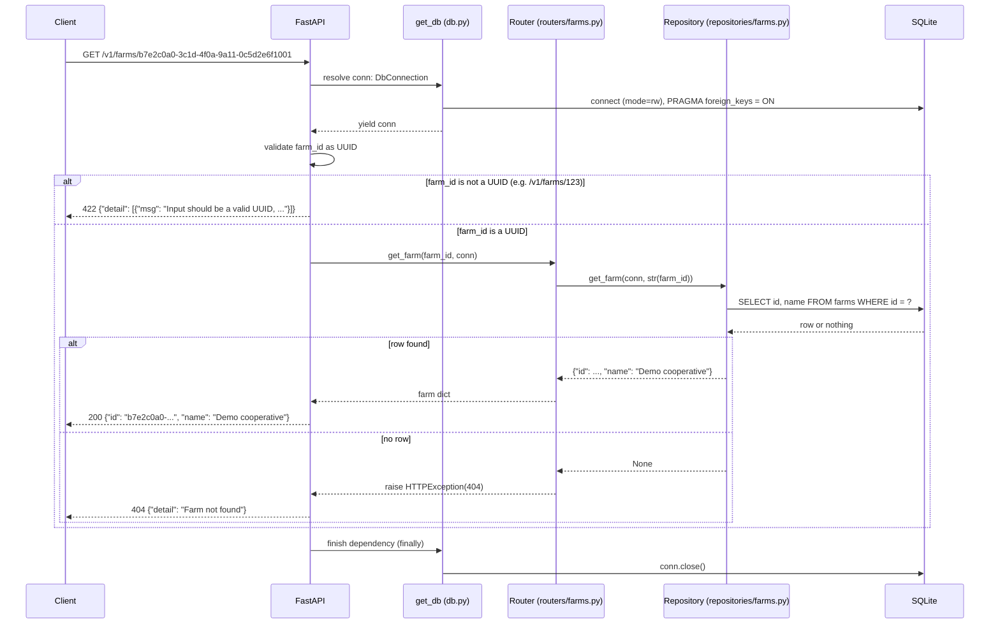

# P1 walkthrough: registry-service, increment by increment

This is a learning document for the P1 Registry Service API. It explains every file that P1 added or changed, in the order the increments were built, and ends each increment with interview questions. The code itself has almost no comments; the explanations live here.

All paths are relative to `services/registry-service/` unless they start with the repository root.

---

## Request flow at a glance

One request, `GET /v1/farms/{farm_id}`, through every layer. FastAPI runs the `get_db` dependency before it validates path parameters, so even a `422` opens and closes a connection. Increments 3 and 5 explain each step.



---

## Increment 0: database setup

**Files:** `seed_registry.sh` (copied unchanged from the course), root `.gitignore`, root `CLAUDE.md`.

### `seed_registry.sh`

It is the course's script, byte for byte (its SHA-256 checksum matches the course copy). You run it; you don't edit it.

- `set -euo pipefail`: stop on the first failing command (`-e`), treat an unset variable as an error (`-u`), and fail a pipeline if any part of it fails (`pipefail`).
- `command -v sqlite3`: checks that the `sqlite3` CLI exists before doing anything.
- `db="${1:-registry.db}"`: the target file is the first argument, or `registry.db` if no argument is given. **This is how tests and the benchmark get their own database:** they pass a temporary path.
- `rm -f "$db"`: deletes the target first. That is why the script is "safe to run again", and also why it must never be pointed at a file holding data you want to keep.
- `CREATE TABLE ...`: the schema. Three things in it shape the whole service:
  - `REFERENCES farms(id)` etc. are **foreign keys**: a plot must point at an existing farm, crop, soil, and emitter.
  - `UNIQUE (farm_id, name)`: a plot name is unique *within one farm*. The same name on another farm is allowed.
  - `REAL` columns (`area_m2`, `lat`, ...) store floating-point numbers. Inserting the integer `1000` stores `1000.0`.
- `PRAGMA foreign_keys = ON` at the top only affects the script's own connection. SQLite does not save this setting in the file (see trap 4 in increment 5).

### `.gitignore`

```gitignore
# Local SQLite database (rebuilt by seed_registry.sh)
registry.db*
```

The `*` also matches SQLite's side files (`registry.db-journal`, `-wal`, `-shm`). The database is generated data, so it must not be committed. Anyone can rebuild it with the seed script.

### `CLAUDE.md`

One added rule: if the specification cannot be accessed, report it instead of guessing the requirements.

### Interview questions

1. Why does the seed script accept a path argument, and what would go wrong in tests if it didn't?
2. What does `set -euo pipefail` protect you from in a shell script?
3. `PRAGMA foreign_keys = ON` appears in the seed script. Why is that not enough for the running service?
4. Why is `registry.db` ignored by Git instead of committed?

---

## Increment 1: test tooling

**Files:** `pyproject.toml`, `uv.lock`, `tests/conftest.py`, `tests/test_health.py`.

### `pyproject.toml`

```toml
[dependency-groups]
dev = [
    "httpx2~=2.16",
    "pytest~=9.2",
]
```

- A **dependency group** holds packages you need while developing, not while running the service. `uv sync` installs the `dev` group by default; a production install could skip it.
- `~=2.16` means "2.16 or newer, but below 3.0". You get bug fixes and minor releases, but not the next major version, which may break things. This is the same rule as `fastapi~=0.115`.
- `httpx2`: Starlette's `TestClient` uses it to send requests to the app in memory (Starlette 1.10 imports `httpx2` first).

```toml
[tool.pytest.ini_options]
pythonpath = ["."]
testpaths = ["tests"]
```

- `pythonpath = ["."]`: adds the service directory to Python's import path, so `from main import app` works inside tests. It's needed because the service is not an installed package (`package = false`).
- `testpaths = ["tests"]`: `uv run pytest` looks only in `tests/`.

### `tests/conftest.py`

`conftest.py` is a file pytest loads automatically. Its **fixtures** are reusable setup functions that a test requests by naming them as a parameter.

```python
SERVICE_DIR = Path(__file__).resolve().parent.parent
SEED_SCRIPT = SERVICE_DIR / "seed_registry.sh"
```

These are absolute paths computed from this file's location, so the tests work from any working directory.

```python
def seed_database(path: Path) -> None:
    subprocess.run(["bash", str(SEED_SCRIPT), str(path)], check=True, capture_output=True)
```

This runs the real seed script into `path`. `check=True` raises an error if the script fails, and `capture_output=True` hides its "Wrote ..." message. Using the real script means tests run against the real schema, not a copy that could drift.

```python
@pytest.fixture(autouse=True)
def isolated_db_path(tmp_path, monkeypatch) -> Path:
    path = tmp_path / "registry.db"
    monkeypatch.setenv("REGISTRY_DB_PATH", str(path))
    return path
```

- `autouse=True`: this runs for **every** test, even tests that don't ask for it. It's a safety net: no test can ever reach the real `registry.db`.
- `tmp_path`: a built-in pytest fixture that gives each test its own empty temporary folder.
- `monkeypatch.setenv`: sets the environment variable for this test only and restores it afterwards.
- The file is not created here. A test that wants a missing database simply doesn't seed it.

```python
@pytest.fixture
def seeded_db(isolated_db_path) -> Path:
    seed_database(isolated_db_path)
    return isolated_db_path


@pytest.fixture
def client(seeded_db) -> TestClient:
    return TestClient(app)
```

Fixtures can depend on other fixtures. Asking for `client` therefore means: isolate the path, then seed it, then build a `TestClient`. `TestClient(app)` calls the app in the same process, with no network.

```python
@pytest.fixture
def live_server(seeded_db):
    with socket.socket() as sock:
        sock.bind(("127.0.0.1", 0))
        port = sock.getsockname()[1]
```

Binding to port `0` asks the operating system for any free port. The socket is then closed and the port number reused for uvicorn. (Another program could take the port in between, but that is very unlikely on a laptop.)

```python
    process = subprocess.Popen(
        [sys.executable, "-m", "uvicorn", "main:app", "--host", "127.0.0.1", "--port", str(port)],
        cwd=SERVICE_DIR,
        env={**os.environ, "REGISTRY_DB_PATH": str(seeded_db)},
        stdout=subprocess.DEVNULL,
        stderr=subprocess.DEVNULL,
    )
```

- `Popen` starts uvicorn as a separate process and does not wait for it. This is a **real server** with real threads, unlike `TestClient`.
- `sys.executable` is the Python running the tests, which is the `.venv` one, so uvicorn comes from the same environment.
- `cwd=SERVICE_DIR`: `main:app` only resolves from the service directory.
- `env={**os.environ, ...}`: copies the current environment and adds the temporary database path.

```python
    try:
        deadline = time.monotonic() + 10
        while True:
            try:
                urllib.request.urlopen(f"{base_url}/health", timeout=1)
                break
            except OSError:
                if time.monotonic() > deadline:
                    raise
                time.sleep(0.1)
        yield base_url
    finally:
        process.terminate()
        process.wait(timeout=10)
```

- The loop polls `/health` until the server answers, for up to 10 seconds. `OSError` covers "connection refused" while uvicorn is still starting.
- `time.monotonic()` is a clock that never jumps backwards, which is right for measuring elapsed time.
- `yield base_url`: the test runs at this point. Everything after `yield` is cleanup.
- `finally`: the server is always stopped, even if the test fails.

### `tests/test_health.py`

This calls `GET /health` and checks the status code and the exact body. It's the simplest possible check that the test setup works.

### Interview questions

1. What is a pytest fixture, and how does a test ask for one?
2. Why is `isolated_db_path` marked `autouse=True`? What could happen without it?
3. What is the difference between `TestClient(app)` and the `live_server` fixture? When do you need the second one?
4. Why is `pytest` in a dependency group and not in `dependencies`?
5. What does `~=9.2` allow and forbid?

---

## Increment 2: removed

The original plan had a custom error layer here (`errors.py`, RFC 9457 `problem+json`). The instructor confirmed that FastAPI's default error responses are enough, so nothing was built. Errors look like `{"detail": "..."}`.

---

## Increment 3: database connection and catalogues (FR-1.2)

**Files:** `db.py`, `schemas.py` (catalogue models), `repositories/catalogues.py`, `routers/catalogues.py`, `main.py`, `routers/__init__.py`, `repositories/__init__.py`, `tests/test_catalogues.py`.

The `__init__.py` files are empty. They mark `routers/` and `repositories/` as regular Python packages, so `from routers import catalogues` works.

### `db.py`

```python
DEFAULT_DB_PATH = Path(__file__).resolve().parent / "registry.db"
```

This is `registry.db` next to `db.py`, as an absolute path, so the default doesn't depend on where you start uvicorn.

```python
def get_db_path() -> Path:
    return Path(os.environ.get("REGISTRY_DB_PATH", DEFAULT_DB_PATH))
```

It reads the environment variable **on every call**, not once at import. That's why a test can change the variable with `monkeypatch` and the very next request uses the new file.

```python
def get_db() -> Iterator[sqlite3.Connection]:
    uri = get_db_path().resolve().as_uri() + "?mode=rw"
    conn = sqlite3.connect(uri, uri=True, check_same_thread=False)
    try:
        conn.row_factory = sqlite3.Row
        conn.execute("PRAGMA foreign_keys = ON")
        yield conn
    finally:
        conn.close()
```

- `get_db` is a **FastAPI dependency with `yield`**. FastAPI runs the code before `yield` before the endpoint, hands the endpoint `conn`, and runs the `finally` block after the endpoint, even when it raised an error. That's how every connection gets closed.
- `.as_uri()` turns a path into `file:///...`, escaping spaces and special characters. `?mode=rw` means "open read-write, and **never create** the file". Without it, a typo in the path would silently create a new, empty database.
- `uri=True` tells `sqlite3` to read the string as a URI.
- `check_same_thread=False`: FastAPI may run the dependency and the endpoint in different worker threads. By default, `sqlite3` refuses to use a connection from a thread other than the one that created it. This is safe here because each connection is used by only one request at a time. (Trap 1: the default made 3 tests fail in the mutation check.)
- `row_factory = sqlite3.Row` makes rows act like dictionaries, so `dict(row)` gives `{"id": ..., "name": ...}`.
- `PRAGMA foreign_keys = ON`: SQLite checks foreign keys **only if each connection asks**. One connection per request means one PRAGMA per request.

```python
DbConnection = Annotated[sqlite3.Connection, Depends(get_db)]
```

This is a reusable type. An endpoint parameter `conn: DbConnection` means "give me a connection from `get_db`". It saves repeating `Depends(get_db)` in 16 places.

### `schemas.py` (catalogue part)

`Crop`, `Soil`, and `Emitter` are **response models**: they list exactly the fields the API returns. FastAPI checks each response against them and drops anything extra. (The spec says "Return only the fields listed here".)

### `repositories/catalogues.py`

All six functions follow the same two patterns:

```python
def list_crops(conn: sqlite3.Connection) -> list[dict]:
    return [dict(row) for row in conn.execute("SELECT id, name FROM crops")]


def get_crop(conn: sqlite3.Connection, crop_id: str) -> dict | None:
    row = conn.execute("SELECT id, name FROM crops WHERE id = ?", (crop_id,)).fetchone()
    return dict(row) if row else None
```

- A repository only runs SQL and returns plain data. It knows nothing about HTTP: it returns `None`, and the router decides that means 404.
- `?` is a **placeholder**. `sqlite3` passes `crop_id` separately from the SQL text, so a value like `x' OR '1'='1` can never change the query. That is protection against **SQL injection**. `(crop_id,)` is a one-item tuple; the comma is required.
- Columns are named explicitly instead of `SELECT *`, so a new column in the table never leaks into the API.

### `routers/catalogues.py`

```python
router = APIRouter(prefix="/v1", tags=["catalogues"])


@router.get("/crops/{crop_id}", response_model=Crop)
def get_crop(crop_id: str, conn: DbConnection):
    crop = catalogue_repository.get_crop(conn, crop_id)
    if crop is None:
        raise HTTPException(status_code=404, detail="Crop not found")
    return crop
```

- `APIRouter` groups routes. `prefix="/v1"` is added to every path. `tags` group the routes in Swagger UI.
- `{crop_id}` in the path becomes the function parameter `crop_id`. Catalogue IDs are words like `tomato`, so the type is `str`.
- `raise HTTPException(...)` is FastAPI's standard way to return an error. Its default handler sends `{"detail": "Crop not found"}` with status 404.
- `def`, not `async def`: `sqlite3` calls **block** the thread. FastAPI runs plain `def` endpoints in a thread pool, so a slow query doesn't freeze other requests. An `async def` endpoint calling `sqlite3` would block the single event loop and stall every request.
- `from repositories import catalogues as catalogue_repository` uses a clear alias, because this router module is also called `catalogues`.
- **405:** only `GET` is defined on these paths, so FastAPI answers any other method with `405`, an `Allow: GET` header, and `{"detail": "Method Not Allowed"}`. FR-1.2 needs no extra code.

### `main.py` (increment 3 part)

`app.include_router(catalogues.router)` attaches the router's routes to the app.

### `tests/test_catalogues.py`

- The three `..._matches_spec_example` tests compare against the exact JSON in the spec.
- The list tests compare **sets of IDs**, because the API does not promise an order.
- `@pytest.mark.parametrize` runs one test function many times with different values. Two stacked decorators give every combination: 4 methods × 6 routes = 24 tests for 405.
- `test_parallel_catalogue_requests_against_real_server` uses `ThreadPoolExecutor(max_workers=50)` to send 50 requests at the same moment to the real uvicorn server. `pool.map(fetch, paths[:50])` runs `fetch` on each path in parallel and returns the results in order. Every result must be 200, and the second one, which is `/v1/crops/tomato`, must have the right body.

### Interview questions

1. What does a FastAPI dependency with `yield` guarantee, and which line in `get_db` depends on that guarantee?
2. Why `?mode=rw`? What would happen without it if `REGISTRY_DB_PATH` had a typo?
3. Why is `check_same_thread=False` needed, and why is it safe in this design?
4. Why are the endpoints `def` and not `async def`?
5. How do `?` placeholders prevent SQL injection?

---

## Increment 4: database outage → 503

**Files:** `db.py` (classification), `main.py` (handler), `tests/test_database_errors.py`.

### The problem

Python's `sqlite3` raises the **same exception type**, `OperationalError` with the result code `SQLITE_ERROR`, for an SQL typo and for a missing table. The plan's first idea, "every `OperationalError` is an outage", would have reported programming bugs as 503 "try again later". Clients would then retry forever against a bug.

This was measured with the installed Python 3.12:

| Situation | Exception | `sqlite_errorname` |
| --- | --- | --- |
| Missing file (`mode=rw`) | `OperationalError` | `SQLITE_CANTOPEN` |
| Corrupt file | `DatabaseError` | `SQLITE_NOTADB` |
| Empty file, no tables | `OperationalError` | `SQLITE_ERROR` |
| SQL typo | `OperationalError` | `SQLITE_ERROR` |
| Duplicate unique value | `IntegrityError` | `SQLITE_CONSTRAINT_UNIQUE` |

### `db.py` (classification)

```python
UNAVAILABLE_ERROR_NAMES = (
    "SQLITE_CANTOPEN",
    "SQLITE_NOTADB",
    "SQLITE_CORRUPT",
    "SQLITE_IOERR",
    "SQLITE_BUSY",
    "SQLITE_LOCKED",
    "SQLITE_FULL",
    "SQLITE_READONLY",
)
```

These are SQLite result codes that mean "the file can't be used right now": it can't be opened, isn't a database, is damaged, the disk failed or is full, another writer holds the lock, or it's read-only. `SQLITE_ERROR` is deliberately missing.

```python
def is_unavailable(exc: sqlite3.DatabaseError) -> bool:
    error_name = getattr(exc, "sqlite_errorname", None) or ""
    return error_name.startswith(UNAVAILABLE_ERROR_NAMES)
```

- `sqlite_errorname` exists since Python 3.11. `getattr(..., None)` handles errors that Python itself raises without a SQLite code (for example a `ProgrammingError` for a wrong number of `?` values), and `or ""` turns `None` into an empty string.
- `str.startswith` accepts a **tuple** and returns `True` if any item matches. Prefix matching also covers extended codes such as `SQLITE_IOERR_READ`.

### `main.py` (handler)

```python
@app.exception_handler(sqlite3.DatabaseError)
async def database_error_handler(request: Request, exc: sqlite3.DatabaseError):
    if not is_unavailable(exc):
        raise exc
    logger.warning("Database unavailable: %s", exc)
    return await http_exception_handler(
        request,
        HTTPException(status_code=503, detail="Database unavailable", headers={"Retry-After": "5"}),
    )
```

- `@app.exception_handler(sqlite3.DatabaseError)` is FastAPI's standard hook. It runs whenever a `DatabaseError`, or any subclass such as `OperationalError` or `IntegrityError`, escapes an endpoint or a dependency.
- `raise exc` for anything that isn't an outage: the exception continues to Starlette's last-resort handler, which returns a plain-text `500 Internal Server Error` without internal details.
- `logger.warning(...)`: every 503 leaves a trace in the uvicorn terminal.
- `http_exception_handler` is **FastAPI's own default handler**. Calling it guarantees the 503 body looks exactly like every other error (`{"detail": ...}`), plus the `Retry-After: 5` header the spec requires, which tells clients to wait 5 seconds.
- The handler is `async def` because `http_exception_handler` is `async`, and `await` can only be used inside `async def`. It does no database work, so it doesn't block.

### `tests/test_database_errors.py`

- `test_missing_database_file_returns_503` uses only `isolated_db_path`, without seeding, so the file doesn't exist. It also asserts the file **still** doesn't exist afterwards, which proves `mode=rw` never creates it.
- `test_corrupt_database_file_returns_503` writes junk bytes, then expects 503.
- `test_health_stays_ok_without_database`: `/health` never touches the database, so it stays `200`.
- `test_reseeding_recovers_without_restart`: a 503, then the seed, then 200 with the **same** client. This works because each request opens a new connection.
- `test_sql_bug_returns_500_not_503` uses `monkeypatch.setattr` to swap `list_crops` for a function with a typo (`SELEC`). `TestClient(app, raise_server_exceptions=False)` is needed because, by default, `TestClient` re-raises server errors inside the test instead of returning the 500 response.
- `test_unseeded_empty_file_returns_500` records the deliberate consequence of the classification: an empty file has no tables, which looks exactly like a typo, so it's a 500.
- `test_is_unavailable_classification` tests the function directly with fake exceptions, including an extended code and `None`.

### Interview questions

1. Why can't you decide "outage or bug" from the exception **type** alone in Python's `sqlite3`?
2. What does `Retry-After` tell a client, and why must it never be sent for a bug?
3. What happens to an `IntegrityError` that no router catches? Follow it through the handler.
4. Why does the test for a 500 need `raise_server_exceptions=False`?
5. Why is the 503 body built with FastAPI's `http_exception_handler` instead of a hand-written `JSONResponse`?

---

## Increment 5: farms (FR-1.1)

**Files:** `schemas.py` (farm models), `repositories/farms.py`, `routers/farms.py`, `main.py`, `tests/test_farms.py`.

### `schemas.py` (farm part)

```python
Name = Annotated[str, Field(min_length=1)]
```

`Annotated` attaches rules to a type. `Name` is "a string with at least one character", reused for farm and plot names. The spec says "non-empty", so an empty string is rejected; spaces are not stripped, because the spec doesn't ask for that.

```python
class FarmCreate(BaseModel):
    model_config = ConfigDict(extra="forbid")

    name: Name


class FarmUpdate(BaseModel):
    model_config = ConfigDict(extra="forbid")

    name: Name = None


class Farm(BaseModel):
    id: UUID
    name: str
```

- **Three models, three jobs:** what a client may send to create (`FarmCreate`), what a client may send to update (`FarmUpdate`), and what the API returns (`Farm`).
- `extra="forbid"`: an unknown field such as `{"nmae": "x"}` or `{"id": ...}` is a 422. Without it, a typo in a PATCH would return 200 and change nothing.
- `name: Name = None` (trap 3): the default `None` is only used when the field is **missing**. Pydantic does not check defaults, so an omitted name is fine. An explicit `{"name": null}` is checked against `str` and rejected. Writing `Optional[str]` would have allowed `null`, and the database's `NOT NULL` would then have failed as a 500.
- `Farm.id: UUID` makes Swagger show the format; the value is printed back as the usual lowercase string.

### `repositories/farms.py`

```python
def create_farm(conn: sqlite3.Connection, name: str) -> dict:
    farm = {"id": str(uuid4()), "name": name}
    with conn:
        conn.execute("INSERT INTO farms (id, name) VALUES (:id, :name)", farm)
    return farm
```

- `uuid4()` makes a random ID. `str(...)` stores it as text, matching the seed data.
- `:id` and `:name` are **named placeholders** filled from the dictionary. They are as safe as `?`.
- `with conn:` is a **transaction**: if the block finishes, `sqlite3` commits; if it raises, it rolls back. Without a commit, the change would vanish when the connection closes.

```python
def update_farm_name(conn: sqlite3.Connection, farm_id: str, name: str) -> bool:
    with conn:
        cursor = conn.execute("UPDATE farms SET name = ? WHERE id = ?", (name, farm_id))
    return cursor.rowcount == 1


def delete_farm(conn: sqlite3.Connection, farm_id: str) -> bool:
    with conn:
        cursor = conn.execute("DELETE FROM farms WHERE id = ?", (farm_id,))
    return cursor.rowcount == 1
```

`cursor.rowcount` is how many rows the statement changed. A count of 0 means the ID didn't exist, which the router turns into a 404. Checking the count, instead of doing a separate SELECT first, also handles a farm deleted by another request in between.

### `routers/farms.py`

```python
def get_farm_or_404(conn: sqlite3.Connection, farm_id: UUID) -> dict:
    farm = farm_repository.get_farm(conn, str(farm_id))
    if farm is None:
        raise HTTPException(status_code=404, detail="Farm not found")
    return farm
```

This is a small helper used by GET and PATCH. `str(farm_id)` converts the `UUID` object to the lowercase text stored in SQLite (trap 8). That's also why an uppercase UUID in the URL still finds the farm.

```python
@router.post("", status_code=201, response_model=Farm)
def create_farm(body: FarmCreate, conn: DbConnection):
    return farm_repository.create_farm(conn, body.name)
```

- `body: FarmCreate`: FastAPI reads the JSON body, validates it, and returns a 422 with details if it's invalid, before this function runs.
- `""` plus the prefix gives `/v1/farms`. `status_code=201` is "Created".

```python
@router.get("/{farm_id}", response_model=Farm)
def get_farm(farm_id: UUID, conn: DbConnection):
    return get_farm_or_404(conn, farm_id)
```

`farm_id: UUID` makes a non-UUID in the URL a 422. This was your decision; an unknown but valid UUID gives a 404.

```python
@router.patch("/{farm_id}", response_model=Farm)
def update_farm(farm_id: UUID, body: FarmUpdate, conn: DbConnection):
    if "name" in body.model_fields_set:
        if not farm_repository.update_farm_name(conn, str(farm_id), body.name):
            raise HTTPException(status_code=404, detail="Farm not found")
    return get_farm_or_404(conn, farm_id)
```

- `model_fields_set` is the set of fields the client actually **sent**. `PATCH {}` sends nothing, so no UPDATE runs (trap 2), and the farm is returned unchanged, or 404 if it doesn't exist.
- The final `get_farm_or_404` returns what is really stored now.

```python
@router.delete("/{farm_id}", status_code=204)
def delete_farm(farm_id: UUID, conn: DbConnection) -> None:
    try:
        deleted = farm_repository.delete_farm(conn, str(farm_id))
    except sqlite3.IntegrityError as exc:
        if exc.sqlite_errorname == "SQLITE_CONSTRAINT_FOREIGNKEY":
            raise HTTPException(status_code=409, detail="Farm still has plots") from exc
        raise
    if not deleted:
        raise HTTPException(status_code=404, detail="Farm not found")
```

- Deleting a farm that still has plots breaks a foreign key, so SQLite raises `IntegrityError` with `SQLITE_CONSTRAINT_FOREIGNKEY`. That becomes 409 Conflict. Any other integrity error is re-raised, ending as a 500.
- `from exc` keeps the original error attached for debugging.
- 204 means "No Content": FastAPI sends an empty body.
- This relies on `PRAGMA foreign_keys = ON` in `get_db` (trap 4). With that line removed, the 409 test fails, which the mutation check confirmed.

### `main.py`

`app.include_router(farms.router)`.

### `tests/test_farms.py`

- `UUID(farm["id"])` raises if the server returned something that isn't a UUID; the test needs no `assert` for that.
- `test_create_farm_rejects_invalid_body` is parametrized over five bad bodies: missing name, empty name, `null`, a number, and an extra `id` field.
- `test_create_farm_without_json_content_type_returns_422` covers trap 10: a body sent without `Content-Type: application/json` is not read as JSON.
- `test_patch_farm_rejects_invalid_body` also re-reads the farm, to prove a failed PATCH changed nothing.
- `test_parallel_farm_creation_against_real_server`: 20 parallel POSTs against real uvicorn. All return 201, and the list then has 2 + 20 = 22 farms. Nothing was lost under concurrent writes.

### Interview questions

1. What does `with conn:` do, on success and on an exception?
2. Why does `FarmUpdate` use `name: Name = None` and not `Optional[str] = None`? Give the request that tells them apart.
3. How does the API return 409 for deleting a farm with plots, and which single line in `db.py` makes it work?
4. Why use `cursor.rowcount` instead of a SELECT before the UPDATE or DELETE?
5. What is the difference between 404 for `/v1/farms/<valid unknown UUID>` and 422 for `/v1/farms/abc`?

---

## Increment 6: plot validation models (FR-1.3)

**Files:** `schemas.py` (plot models), `tests/test_plot_models.py`.

### Shared field types

```python
def not_in_future(value: str) -> str:
    if date.fromisoformat(value) > date.today():
        raise ValueError("planting_date must not be in the future")
    return value
```

- `date.fromisoformat` turns `"2026-03-01"` into a date and raises `ValueError` for impossible dates such as `"2026-02-30"`.
- `date.today()` runs **on every validation** (trap 6). Computed once at import, the "today" would freeze on the day the server started.
- Today counts as "not in the future", so it's accepted. The date is the server's local date.
- Pydantic turns the `ValueError` into a 422 with the message.

```python
PositiveNumber = Annotated[float, Field(gt=0, strict=True, allow_inf_nan=False)]
Latitude = Annotated[float, Field(ge=-90, le=90, strict=True, allow_inf_nan=False)]
Longitude = Annotated[float, Field(ge=-180, le=180, strict=True, allow_inf_nan=False)]
```

- `gt=0` means strictly greater than 0. `ge` and `le` are inclusive, matching "from -90 to 90".
- `strict=True` (trap 5): by default Pydantic would accept `true` as `1.0` and `"1000"` as `1000.0`. Strict mode accepts only real numbers. Integers are still allowed, so the spec's `"area_m2": 1000` passes.
- `allow_inf_nan=False`: rejects infinity and "not a number", which are valid floats but not valid areas.

```python
PlantingDate = Annotated[str, Field(pattern=r"^[0-9]{4}-[0-9]{2}-[0-9]{2}$"), AfterValidator(not_in_future)]
```

- Kept as a **string**, not `date`, because Pydantic's `date` type would accept `0` (as 1970-01-01) and full timestamps. The spec fixes the format `YYYY-MM-DD`.
- `pattern` is a regular expression: `^` is the start, `[0-9]{4}` is exactly four digits, `$` is the end. `[0-9]` is used instead of `\d`, because `\d` also matches digits from other alphabets.
- `AfterValidator(not_in_future)` runs after the pattern matched, to check that the date exists and isn't in the future.

### The three plot models

- `PlotCreate`: every field required, `extra="forbid"`, using the shared types. `farm_id: UUID` makes a bad farm ID a 422.
- `PlotUpdate`: the same fields, all `= None`, so each can be omitted but none can be `null`. Because the **same** `Annotated` types are used, every FR-1.3 rule applies to PATCH too.
- `Plot`: the response model, with exactly the spec's 12 fields.

Why the duplication between `PlotCreate` and `PlotUpdate`? The only difference is "required" versus "optional". Writing both out keeps each model readable on its own, and the rules live in the shared types, so they can't drift apart.

### `tests/test_plot_models.py`

These tests check the models directly with `PlotCreate.model_validate(...)`: no HTTP and no database, so they're fast and pinpoint the rule that failed.

- `VALID_PLOT` is the spec's example. `{**VALID_PLOT, field: value}` copies it and changes one field. Every case changes **exactly one** thing, so a rejection can only be caused by that change.
- `test_boundary_values_are_accepted`: today, ±90, ±180, and a tiny positive area. Off-by-one mistakes hide at boundaries.
- `test_invalid_values_are_rejected`: 21 cases covering every FR-1.3 rule and every leniency trap.
- `test_every_field_is_required` removes one field at a time.
- `test_update_tracks_only_sent_fields` and `test_empty_update_is_valid` show `exclude_unset=True`, which is what PATCH relies on.
- `test_update_rejects_null` runs for every field.

### Interview questions

1. Why is `planting_date` a `str` with a pattern instead of a `date`?
2. What does `strict=True` reject that the default would accept? Why are integers still allowed?
3. Why must `date.today()` be called inside the validator?
4. How do `PlotCreate` and `PlotUpdate` share rules, and why does that matter for PATCH?
5. Why does each invalid-value test case change exactly one field?

---

## Increments 7 and 8: plots (FR-1.1, FR-1.3)

**Files:** `repositories/plots.py`, `routers/plots.py`, `main.py`, `tests/test_plots.py`.

### `repositories/plots.py`

```python
SELECT_PLOTS = """
    SELECT id, farm_id, name, area_m2, crop_id, planting_date, soil_id,
           row_spacing_m, emitter_spacing_m, emitter_id, lat, lon
    FROM plots
"""
```

This is the column list, written once and reused by list and get. `list_plots` appends `" WHERE farm_id = ?"` when filtering. That's string joining of **fixed** text only; the value still goes through `?`.

```python
def create_plot(conn: sqlite3.Connection, fields: dict) -> dict:
    plot = {"id": str(uuid4()), **fields}
    with conn:
        conn.execute(INSERT_PLOT, plot)
    return plot
```

`INSERT_PLOT` is a fixed statement with named placeholders. `{"id": ..., **fields}` builds one dictionary from the new ID and the validated fields.

```python
def update_plot(conn: sqlite3.Connection, plot_id: str, changes: dict) -> bool:
    if not changes.keys() <= UPDATABLE_COLUMNS:
        raise ValueError(f"Not updatable: {changes.keys() - UPDATABLE_COLUMNS}")
    assignments = ", ".join(f"{column} = :{column}" for column in changes)
    with conn:
        cursor = conn.execute(f"UPDATE plots SET {assignments} WHERE id = :id", {**changes, "id": plot_id})
    return cursor.rowcount == 1
```

- PATCH changes only the fields that were sent, so the `SET` list must be built for each request: `{"name": "X", "lat": 1}` becomes `name = :name, lat = :lat`.
- Column **names** can't be placeholders in SQL, so they are put into the text. That's only safe if they can't come from the user. They come from `PlotUpdate`, which forbids unknown fields, and the `<=` check (subset) against `UPDATABLE_COLUMNS` is a second guard inside the repository itself. The **values** still go through placeholders.
- `id` is not updatable: a plot's identity never changes.

### `routers/plots.py`

```python
def check_references(conn: sqlite3.Connection, fields: dict) -> None:
    if "farm_id" in fields and farm_repository.get_farm(conn, fields["farm_id"]) is None:
        raise HTTPException(status_code=404, detail="Farm not found")
    if "crop_id" in fields and catalogue_repository.get_crop(conn, fields["crop_id"]) is None:
        raise HTTPException(status_code=422, detail="Unknown crop")
    ...
```

- `if "x" in fields` makes the same function work for POST (all fields present) and PATCH (only the sent ones).
- An unknown farm is a **404** (your decision). An unknown crop, soil, or emitter is a **422**, the spec's "Unknown emitter".
- Why SELECT first instead of letting the foreign key fail? SQLite's foreign key error doesn't say *which* reference failed, and the spec wants a specific message.

```python
def raise_for_integrity_error(exc: sqlite3.IntegrityError) -> NoReturn:
    if exc.sqlite_errorname == "SQLITE_CONSTRAINT_UNIQUE":
        raise HTTPException(status_code=409, detail="Plot name already exists on this farm") from exc
    if exc.sqlite_errorname == "SQLITE_CONSTRAINT_FOREIGNKEY":
        # The farm passed check_references but was deleted by a concurrent request.
        raise HTTPException(status_code=404, detail="Farm not found") from exc
    raise exc
```

- **Uniqueness is left to the database** (trap 7). A "SELECT, then INSERT if free" check has a gap: two requests can both see "free" and both insert. The `UNIQUE (farm_id, name)` constraint is enforced inside SQLite's write lock, so exactly one wins. The race test proves it: 10 parallel identical POSTs give one 201 and nine 409s.
- It also handles PATCH correctly: renaming a plot to its **own** name is not a conflict, because there is no other row with that name.
- The foreign-key case only happens if a farm is deleted between `check_references` and the INSERT. It maps to the same 404 a missing farm gets.
- `NoReturn` tells readers and type checkers that this function always raises.

```python
@router.post("", status_code=201, response_model=Plot)
def create_plot(body: PlotCreate, conn: DbConnection):
    fields = body.model_dump(mode="json")
    check_references(conn, fields)
    try:
        return plot_repository.create_plot(conn, fields)
    except sqlite3.IntegrityError as exc:
        raise_for_integrity_error(exc)
```

`model_dump(mode="json")` turns the model into a dictionary of JSON-compatible values, so the `UUID` becomes a lowercase string, ready for SQLite. **The order of checks** is:

1. Body validation, 422 (FastAPI, before the function).
2. Farm, 404.
3. Catalogue, 422.
4. Uniqueness, 409.

That runs from the cheapest and most basic check to the most expensive. `test_check_order_...` pins it down.

```python
@router.get("", response_model=list[Plot])
def list_plots(conn: DbConnection, farm_id: UUID | None = None):
    return plot_repository.list_plots(conn, str(farm_id) if farm_id else None)
```

`farm_id` is a **query parameter** (`?farm_id=...`) because it isn't in the path. It's optional, and a non-UUID is a 422. A valid UUID with no plots returns `200 []`, as the spec says.

```python
@router.patch("/{plot_id}", response_model=Plot)
def update_plot(plot_id: UUID, body: PlotUpdate, conn: DbConnection):
    get_plot_or_404(conn, plot_id)
    changes = body.model_dump(mode="json", exclude_unset=True)
    if changes:
        check_references(conn, changes)
        try:
            updated = plot_repository.update_plot(conn, str(plot_id), changes)
        except sqlite3.IntegrityError as exc:
            raise_for_integrity_error(exc)
        if not updated:
            raise HTTPException(status_code=404, detail="Plot not found")
    return get_plot_or_404(conn, plot_id)
```

- 404 first: there's no point checking references for a plot that doesn't exist.
- `exclude_unset=True` keeps only the fields the client sent.
- `if changes:` (trap 2): with `{}`, the SET list would be empty and the SQL invalid. The mutation check confirmed a test catches this.
- `farm_id` may be changed (moving a plot), with the same 404 and 409 checks.

`delete_plot` follows the farm pattern: `rowcount` 0 gives 404, otherwise 204 with no body.

### `tests/test_plots.py`

- `NORTH_BLOCK` is the full seed row, including `"area_m2": 1000.0`, because SQLite returns `REAL` values as floats. Its ID is a version-5 UUID, which is why the models use `UUID`, not `UUID4`.
- `test_create_spec_example_returns_object_plus_id` checks the spec's sentence "201 returns that object plus id" literally, then reads the plot back.
- `test_create_plot_rejects_fr_1_3_violations` also checks `loc == ["body", field]`, so the 422 comes from the right field.
- `test_parallel_duplicate_creates_allow_exactly_one` is the race test. `urllib` raises `HTTPError` for 4xx responses, so the helper returns its code.
- `test_patch_applies_all_rules` checks the status **and** that the stored plot is unchanged after every failed PATCH. The transaction rolled back, or never started.
- `test_farm_can_be_deleted_after_its_plots` ties farms and plots together: once the plots are gone, the 409 becomes a 204.

### Interview questions

1. Why is the duplicate-name check done by the database instead of a SELECT before the INSERT? Describe the race.
2. In `update_plot`, which parts of the SQL come from the user, and what makes the f-string safe?
3. Why is an unknown farm a 404 but an unknown emitter a 422?
4. What is the order of checks on POST, and why that order?
5. What would `PATCH /v1/plots/{id}` with `{}` do without `if changes:`?

---

## Increment 9: NFR-1.1 benchmark

**Files:** `scripts/measure_p95.py`, standard library only; `tests/test_measure_p95.py`.

### Concepts first

- **Latency** is the time from sending a request until the full response arrives.
- **p95** (95th percentile): sort all latencies. p95 is the value 95% of requests were at or below. It shows the slow tail that an average hides.
- **Open loop**: requests are sent on a fixed schedule, here one every 100 ms (10 per second), whether or not earlier ones have finished. A closed loop ("send the next after the previous returns") slows down when the server slows down, which hides the delay. That mistake is called **coordinated omission**.

### The code

```python
def p95(latencies_ms: list[float]) -> float:
    ordered = sorted(latencies_ms)
    return ordered[math.ceil(0.95 * len(ordered)) - 1]
```

This is the **nearest-rank** method. With 1,200 samples, `ceil(1140) - 1` gives index 1139, the 1,140th smallest. No interpolation, so p95 is always a real measured value.

```python
def run_benchmark(base_url: str, rate: float, duration: float) -> list[tuple[str, int, float]]:
    total = int(rate * duration)
    ...
    start = time.perf_counter() + 0.5
    with ThreadPoolExecutor(max_workers=50) as pool:
        for index in range(total):
            scheduled = start + index / rate
            delay = scheduled - time.perf_counter()
            if delay > 0:
                time.sleep(delay)
            pool.submit(send, ENDPOINTS[index % len(ENDPOINTS)], scheduled)
    return results
```

- Request number `index` is due at `start + index / rate`. The loop sleeps until then and hands it to a worker thread, so a slow response never delays the next send.
- `time.perf_counter()` is the most precise clock for short durations.
- `ENDPOINTS[index % len(ENDPOINTS)]` rotates through the 11 routes.
- Leaving the `with` block waits for every request to finish.

```python
    def send(path: str, scheduled: float) -> None:
        try:
            with urllib.request.urlopen(f"{base_url}{path}", timeout=10) as response:
                response.read()
                status = response.status
        except urllib.error.HTTPError as error:
            status = error.code
        except OSError:
            status = 0
        latency_ms = (time.perf_counter() - scheduled) * 1000
        with lock:
            results.append((path, status, latency_ms))
```

- `response.read()`: the timer covers the whole body, not just the headers.
- Latency is measured from the **scheduled** time, so any waiting for a free worker counts too.
- A 4xx or 5xx response becomes its status code, and a connection failure becomes `0`. Both count as failures.
- `lock`: several threads append to one list, and the lock lets only one append at a time.

`ENDPOINTS` lists only routes that return 200 with the seed data: the 5 list routes (including `?farm_id=`) and 6 get-by-ID routes with existing IDs. **No 404 paths**, because NFR-1.1 is about successful reads.

`main()` puts it together:

1. Parse `--rate` (default 10) and `--duration` (default 120).
2. Seed a database in a `tempfile.TemporaryDirectory()`, which deletes itself afterwards, so the real `registry.db` is never touched.
3. Start uvicorn with `--log-level warning` (one worker, no reload, the same as a normal run) and wait for `/health`.
4. **Warm-up:** request each route once and discard the results, so first-request effects such as Python importing modules don't distort the numbers.
5. Run, stop the server in `finally`, print p50, p95, and max per route and overall, and count non-200 responses. A route with no successful responses prints "no successful responses" instead of disappearing from the table.
6. Decide PASS with `benchmark_passed(results)`, then exit `0` for PASS and `1` otherwise, so the script can gate a CI job.

`benchmark_passed(results)` returns `True` only if all of these hold:

- Every response is `200`.
- The overall p95 is at most 100 ms.
- Every route in `ENDPOINTS` has results, so no route is silently skipped.
- Every route's own p95 is at most 100 ms.

The per-route check matters because each route gets only about 1/11 of the requests. One route could be slow on about half of its requests while the overall p95 still looks fine (JL-003).

`tests/test_measure_p95.py` tests `benchmark_passed` with made-up results, so it runs in milliseconds without a server. The key test makes 5 of one route's 10 samples 200 ms: the overall p95 stays at 10 ms, but that route's p95 is 200 ms, so the result must be FAIL. The other tests check that all-fast results pass, a missing route fails, and a non-200 response fails.

**Methodology notes for the PR:** each request opens a new TCP connection (`urllib` has no keep-alive), which makes the numbers slightly pessimistic. The load generator runs on the same machine as the server.

### Interview questions

1. What is p95, and why use it instead of the average?
2. What is the difference between open-loop and closed-loop load, and what is coordinated omission?
3. Why is latency measured from the scheduled time and not from when the thread started?
4. Why does the benchmark exclude 404 routes, and why does any non-200 fail the run?
5. How is the official benchmark different from an `oha` stress test?
6. Why can the overall p95 pass while one route is slow, and how does `benchmark_passed` catch it?

---

## Increment 10: documentation

**Files:** `README.md` (service), root `CLAUDE.md`, this document.

- The README covers setup, running, configuration, tests, and benchmarks, with commands that were run before being written down. It contains no design discussion; that belongs in `docs/judgment-log.md`.
- `CLAUDE.md` now describes the real architecture and commands, so the next AI session starts from facts instead of "no tests yet".

### Interview questions

1. Who reads a service README, and what must it let them do without help?
2. Why are design decisions kept in a judgment log instead of the README?
3. How would you check that a README's setup instructions really work from a clean clone?
