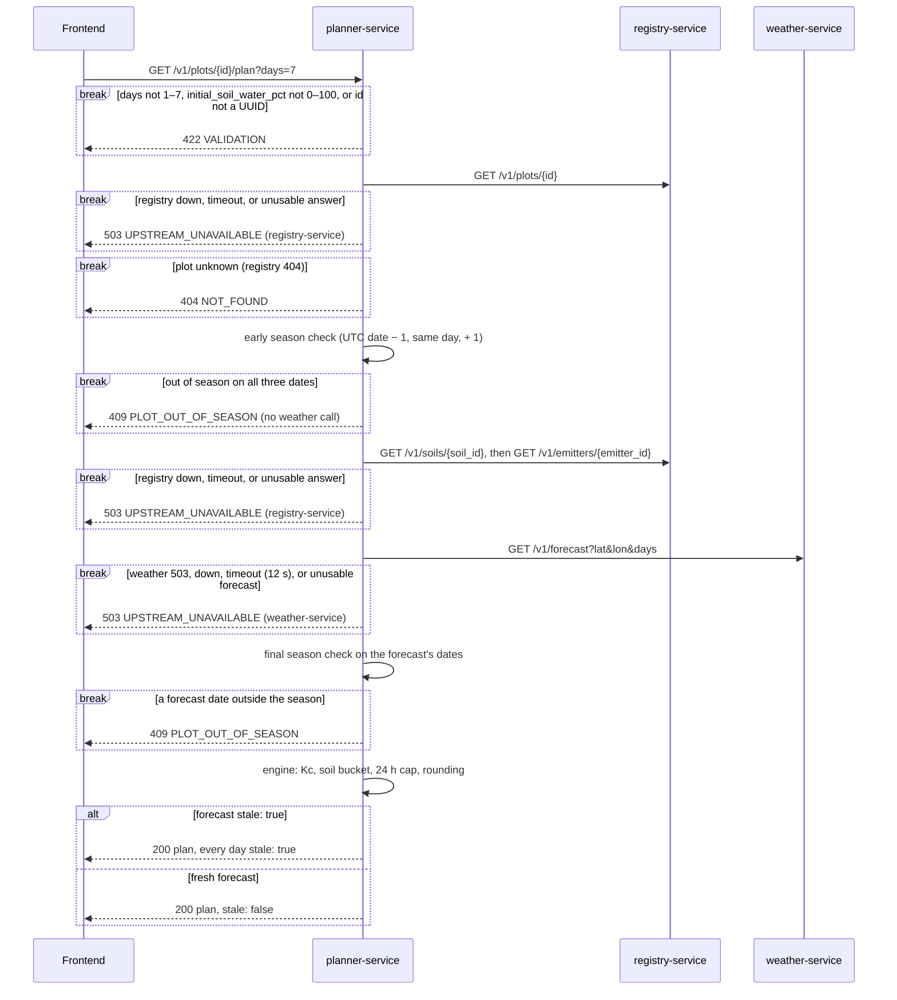

# planner-service

## 1. What is this service?

`planner-service` answers the grower's question: **should I water this plot today, and for how many minutes?** It reads
the plot, its soil and its emitter from `registry-service` and the forecast for the plot's point from `weather-service`.
From those it calculates a day-by-day irrigation plan for 1 to 7 days, starting today.

| Route | Purpose |
| --- | --- |
| `GET /v1/plots/{id}/plan?days={days}` | The irrigation plan of a plot (`days` 1 to 7, default 7). Optional `initial_soil_water_pct` (0–100) simulates another starting soil level |
| `GET /health` | `{"status": "ok"}` |

- Every number in the plan comes from the engine (`engine.py`), calculated exactly as written in the
  [`irrigation-calc-reference`](../../.claude/skills/irrigation-calc-reference/SKILL.md) skill. No AI model computes
  or adjusts a number.
- Errors use `{"code": "...", "detail": "..."}`: `VALIDATION`, `NOT_FOUND`, `PLOT_OUT_OF_SEASON`, `UPSTREAM_UNAVAILABLE`.
- When a service it needs is down, it answers `503`, never a plan of zeros (FR-2.14).

## 2. Prerequisites

| Tool | Needed for | Check |
| --- | --- | --- |
| [uv](https://docs.astral.sh/uv/) | everything | `uv --version` |
| `curl` | the checks in this guide | `curl --version` |
| [`jq`](https://jqlang.org/) (optional) | formatting the JSON in the examples | `jq --version` |
| `registry-service` on 8000, `weather-service` on 8001 | a live plan (tests don't need them). Start them first, as in the [root README](../../README.md#run-the-whole-system-locally) | `curl http://127.0.0.1:8000/health` and `curl http://127.0.0.1:8001/health` |

Python 3.12 is pinned in this folder's `.python-version`. **Run every command from this folder:**

```bash
cd services/planner-service
```

## 3. Quick Start

```bash
uv sync                      # install the locked dependencies into .venv
cp .env.example .env         # first time only; .env is git-ignored
uv run uvicorn main:app --host 127.0.0.1 --port 8002
```

Expected, at the end of the output:

```text
INFO:     Registry: http://127.0.0.1:8000 (timeout 3 s); weather: http://127.0.0.1:8001 (timeout 12 s)
INFO:     Application startup complete.
INFO:     Uvicorn running on http://127.0.0.1:8002 (Press CTRL+C to quit)
```

If a required variable is missing, the service stops at startup with a message that names it, for example
`RuntimeError: Invalid planner-service configuration (see .env.example): REGISTRY_URL: Field required`.

In VS Code or Cursor, the `planner-service` launch configuration runs the same command under the debugger.

## 4. API examples

**A plan.** The plot ids come from registry-service:

```bash
curl http://127.0.0.1:8000/v1/plots | jq '.[] | {id, name, crop_id, planting_date}'
curl 'http://127.0.0.1:8002/v1/plots/<plot id>/plan?days=7' | jq .
```

The four seed plots were planted in February to May 2026 and their seasons are over, so each gets `409
PLOT_OUT_OF_SEASON`. To get a plan, add a plot planted 60 days ago, as in
[Get a plan](../../README.md#get-a-plan-add-a-plot-that-is-in-season) in the root README, and use its id.

This example is a plot with the values of the seed plot "West block" (tomato on sand, 1,500 m², 0.6 L/h emitters) at
mid-season, with the forecast of worked example Case 3. It is the response that `tests/test_plan.py` checks. Day 6 is
an irrigation day, limited by the 24-hour cap.

```json
{
  "plot_id": "3f8a6c2e-1b4d-4e5f-9a7b-0c1d2e3f4a5b",
  "crop_id": "tomato",
  "taw_mm": 58.1,
  "threshold_mm": 29.05,
  "initial_soil_water_pct": 100,
  "forecast_fetched_at": "2026-11-21T06:00:00Z",
  "days": [
    { "date": "2026-11-21", "et0_mm": 6.0, "rain_mm": 0.0, "kc": 1.15, "litres": 0,     "run_minutes": 0,    "bucket_level_mm": 51.2,   "stale": false },
    { "date": "2026-11-22", "et0_mm": 6.0, "rain_mm": 0.0, "kc": 1.15, "litres": 0,     "run_minutes": 0,    "bucket_level_mm": 44.3,   "stale": false },
    { "date": "2026-11-23", "et0_mm": 5.0, "rain_mm": 5.0, "kc": 1.15, "litres": 0,     "run_minutes": 0,    "bucket_level_mm": 43.55,  "stale": false },
    { "date": "2026-11-24", "et0_mm": 6.0, "rain_mm": 0.0, "kc": 1.15, "litres": 0,     "run_minutes": 0,    "bucket_level_mm": 36.65,  "stale": false },
    { "date": "2026-11-25", "et0_mm": 6.0, "rain_mm": 0.0, "kc": 1.15, "litres": 0,     "run_minutes": 0,    "bucket_level_mm": 29.75,  "stale": false },
    { "date": "2026-11-26", "et0_mm": 5.5, "rain_mm": 0.0, "kc": 1.15, "litres": 36000, "run_minutes": 1440, "bucket_level_mm": 47.425, "stale": false },
    { "date": "2026-11-27", "et0_mm": 6.0, "rain_mm": 0.0, "kc": 1.15, "litres": 0,     "run_minutes": 0,    "bucket_level_mm": 40.525, "stale": false }
  ]
}
```

### What each field means

| Field | What it means |
| --- | --- |
| `plot_id` | Which plot this plan is for |
| `crop_id` | The crop growing on the plot |
| `taw_mm` | How much water the soil around the roots can hold for the crop when it is full |
| `threshold_mm` | Half of `taw_mm`. If the soil would drop below this during a day, the plan waters that day |
| `initial_soil_water_pct` | How full the soil is assumed to be at the start of today, as a % of `taw_mm`. 100 unless a simulation was asked for. Always an assumption, never a measurement |
| `forecast_fetched_at` | When the weather forecast behind this plan was downloaded (UTC time) |
| `days` | One row per day, starting today |
| `date` | The day this row is about. The first row is today at the plot |
| `et0_mm` | How much water a standard patch of grass would lose to sun and wind that day |
| `rain_mm` | How much rain is expected that day |
| `kc` | How much this crop drinks compared with grass, at its age on that day |
| `litres` | How much water to give the whole plot that day (0 means no watering) |
| `run_minutes` | How many minutes to run the drip system (0 means no watering) |
| `bucket_level_mm` | How much available water is expected to remain in the soil at the end of the day |
| `stale` | `true` when no new forecast could be fetched and this day uses an older one |

All water amounts are in mm. 1 mm of water over 1 m² is 1 litre.

**A stale forecast** (FR-2.13): when weather-service answers with an older cached forecast, the plan is still
calculated, every day has `"stale": true`, and `forecast_fetched_at` shows how old the forecast is.

**A simulated starting soil level** (optional): the planner has no soil measurement, so every plan starts from an
assumed level. By default the soil is full this morning (JL-011). `initial_soil_water_pct` (a whole number from 0 to
100) lets you try another start, for example:

```bash
curl 'http://127.0.0.1:8002/v1/plots/<plot id>/plan?initial_soil_water_pct=50' | jq .
```

Only the starting level changes. The bucket size, the half-full line, the refill to full and the 24-hour cap stay the
same. A low start makes today a watering day, often at the 24-hour cap. Treat those numbers as a simulation, not a
field-verified recommendation. The response echoes the value in `initial_soil_water_pct`. Leaving the parameter out
gives exactly the same plan as before.

**Errors:**

| Status | Body | When |
| --- | --- | --- |
| `422` | `{"code": "VALIDATION", "detail": "days: Input should be less than or equal to 7"}` | `days` is not a whole number from 1 to 7, `initial_soil_water_pct` is not a whole number from 0 to 100, or the id is not a UUID. No other service is called. |
| `404` | `{"code": "NOT_FOUND", "detail": "Plot not found."}` | registry-service has no plot with this id |
| `409` | `{"code": "PLOT_OUT_OF_SEASON", "detail": "The plot is outside its growing season."}` | A plan day is before planting or after the season's last day (tomato 180 days, pepper 210). No partial plan. |
| `503` | `{"code": "UPSTREAM_UNAVAILABLE", "detail": "weather-service is unavailable or did not answer in time."}` | A service is down, too slow, or gave an unusable answer. The detail names `registry-service` or `weather-service`. |

## 5. How a request is answered

Each `break` box is a final answer: the planner sends that response and the request stops there. It makes no further
calls.



- **Which "today":** the plan's dates are the forecast's dates, which are the local date at the plot. Before the
  forecast arrives, the planner knows only its own UTC date. UTC offsets run from −12 h to +14 h, so the plot's today
  is that date, the day before, or the day after.
  - The early check answers `409` only when the plan is out of season for all three dates.
  - The final check uses the forecast's real dates.
  - So a plot near midnight never gets a wrong `409`. The cost: a plot within one day of a season boundary needs the
    forecast before its `409`, and if weather-service is down at that moment the answer is `503`.
- **Unusable answer:** any of these gives `503` naming the service, never a default or a 0 (FR-2.8, FR-2.14):
  - a status other than `200`, or a body that isn't JSON
  - a missing field
  - a number that is null, text, NaN or infinite
  - an area, spacing, flow or soil water value that is not above 0
  - a negative ET0 or rain
  - a forecast with the wrong number of days, or days that don't follow one another

  A registry `404` for the plot's soil or emitter is also a registry fault here, because registry's own foreign keys
  forbid it.
- **Timeouts:** `WEATHER_TIMEOUT_SECONDS` (12) is longer than weather-service's own worst case of about 9 s (3 attempts
  × 3 s). Otherwise the planner would give up just before weather-service returns a stale forecast. The planner doesn't
  retry; weather-service already retries the provider.
- **A crop the planner has no profile for** (only tomato and bell-pepper exist in registry's catalogue): the planner
  answers `500`. That would be a bug, a mismatch between the planner and registry, not a reason to make up a Kc.

## 6. How the numbers are calculated

The full rules, with sources and worked examples, are in the
[`irrigation-calc-reference`](../../.claude/skills/irrigation-calc-reference/SKILL.md) skill. The research behind them
is [`docs/research/fao56.md`](docs/research/fao56.md). In short, for each day:

1. **Kc** from the days since planting (the planting day is day 1) and the crop's FAO-56 stages.
2. **The bucket** starts the plan full, or at `initial_soil_water_pct` of full in a simulation: `taw_mm` = soil water
   per metre × root depth. Rain is added at the start of the day, up to full.
3. **The crop's water use** that day is Kc × ET0. If the bucket would end the day below `threshold_mm`, the plan
   refills it to full. That water is limited to 24 hours of the drip system's flow.
4. **Litres** = mm × area. **Run minutes** = litres ÷ (emitters × flow per emitter) × 60. The number of emitters is
   area ÷ (row spacing × emitter spacing).
5. **The bucket at the end of the day** = start + irrigation − water use, never below 0.

All calculations use exact fractions (`fractions.Fraction`), so a day that ends exactly at half really ends at half.
Only the output is rounded, half-up: `kc`, `bucket_level_mm`, `taw_mm` and `threshold_mm` to 3 decimals, and `litres`
and `run_minutes` to whole numbers. `et0_mm` and `rain_mm` are shown exactly as weather-service sent them.

## 7. Configuration

All settings are read by `config.py` with pydantic-settings from the environment or `.env` in this folder. An
environment variable wins over `.env`. `.env` is git-ignored. `.env.example` lists every variable with a safe value.

| Variable | Required | Example | Purpose |
| --- | --- | --- | --- |
| `REGISTRY_URL` | yes | `http://127.0.0.1:8000` | Base URL of registry-service |
| `WEATHER_URL` | yes | `http://127.0.0.1:8001` | Base URL of weather-service |
| `REGISTRY_TIMEOUT_SECONDS` | yes | `3` | Timeout of one registry call, > 0 |
| `WEATHER_TIMEOUT_SECONDS` | yes | `12` | Timeout of one weather call, > 0. Keep it above weather-service's worst case (about 9 s) |

The settings are read once at startup, so restart the service after changing `.env`.

## 8. Run tests & coverage

```bash
uv run pytest            # all tests; no network, no other service, no .env needed
uv run pytest --cov      # with branch coverage; fails below 100%
```

- `tests/test_engine.py` reproduces every value in the skill's
  [worked examples](../../.claude/skills/irrigation-calc-reference/references/worked-examples.md): Cases 1 to 3 and
  boundary cases B1 to B6.
- `tests/test_plan.py` runs the endpoint against a fake registry-service and a fake weather-service
  (`httpx2.MockTransport` in `tests/conftest.py`). Every failure branch in the diagram above is a test.
- Every test uses fixed settings from `tests/conftest.py`, never your `.env`.
