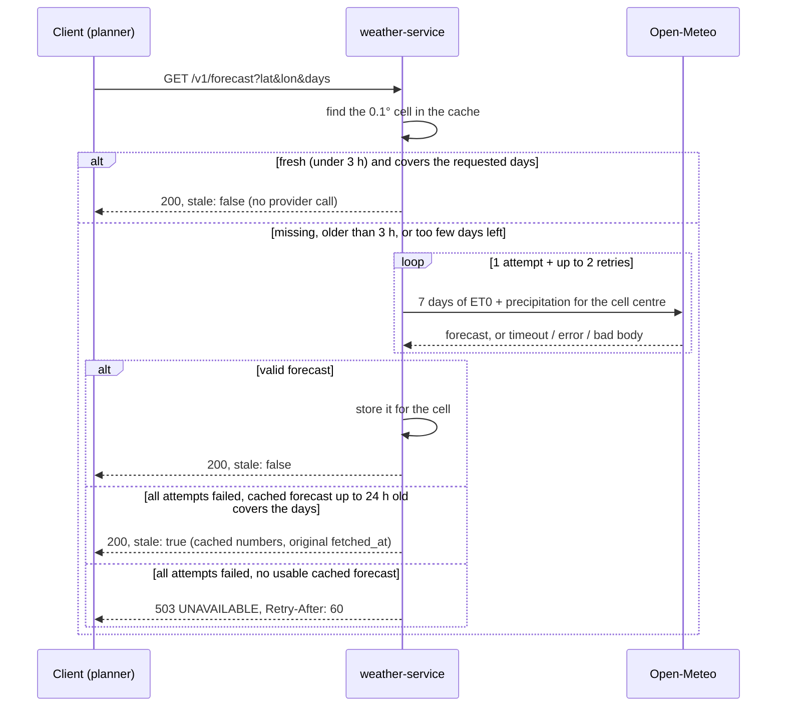

# weather-service

## 1. What is this service?

`weather-service` serves the daily weather forecast that the AgroPilot planner needs: for each of the next 1 to 7 days,
**ET0** (how much water a standard patch of grass loses that day, in mm) and **rain** (mm). It gets the forecast from
[Open-Meteo](https://open-meteo.com/en/docs) ("the provider") and keeps it in memory.

| Route | Purpose |
| --- | --- |
| `GET /v1/forecast?lat={lat}&lon={lon}&days={days}` | The forecast for a point, starting today |
| `GET /health` | `{"status": "ok"}` |

- `planner-service` calls it for every plan. The `frontend` only checks its `/health`. To run the whole system, see
  the [root README](../../README.md#run-the-whole-system-locally).
- The service knows coordinates and dates only, nothing about farms, plots or crops.
- Errors use `{"code": "...", "detail": "..."}` (`VALIDATION`, `UNAVAILABLE`).
- It never answers with numbers the provider didn't give: no zeros and no defaults for a missing day (FR-2.8).

## 2. Prerequisites

| Tool | Needed for | Check |
| --- | --- | --- |
| [uv](https://docs.astral.sh/uv/) | everything | `uv --version` |
| `curl` | the checks in this guide | `curl --version` |
| [`jq`](https://jqlang.org/) (optional) | formatting the JSON in the examples | `jq --version` |
| Internet access | the live provider (tests and benchmark don't need it) | `curl -s https://api.open-meteo.com` |

Python 3.12 is pinned in this folder's `.python-version`. **Run every command from this folder:**

```bash
cd services/weather-service
```

## 3. Quick Start

```bash
uv sync                      # install the locked dependencies into .venv
cp .env.example .env         # first time only; .env is git-ignored
uv run uvicorn main:app --host 127.0.0.1 --port 8001
```

Expected, at the end of the output:

```text
INFO:     Weather provider: https://api.open-meteo.com/v1/forecast (fresh 3 h, stale up to 24 h, 2 retries)
INFO:     Application startup complete.
INFO:     Uvicorn running on http://127.0.0.1:8001 (Press CTRL+C to quit)
```

If a required variable is missing, the service stops at startup with a message that names it, for example
`RuntimeError: Invalid weather-service configuration (see .env.example): PROVIDER_BASE_URL: Field required`.

In VS Code or Cursor, the `weather-service` launch configuration runs the same command under the debugger.

## 4. API examples

**A fresh forecast** (`days` is optional, default 7):

```bash
curl 'http://127.0.0.1:8001/v1/forecast?lat=31.25&lon=34.79&days=3' | jq .
```

```json
{
  "lat": 31.25,
  "lon": 34.79,
  "source": "open-meteo",
  "fetched_at": "2026-11-21T17:08:48Z",
  "stale": false,
  "days": [
    { "date": "2026-11-21", "et0_mm": 3.15, "rain_mm": 0.0 },
    { "date": "2026-11-22", "et0_mm": 2.65, "rain_mm": 0.0 },
    { "date": "2026-11-23", "et0_mm": 2.63, "rain_mm": 0.0 }
  ]
}
```

- `lat`/`lon` echo the request. `fetched_at` is when the provider was called (UTC).
- `date` is the local date at the point: the first day is "today" where the field is.

**A stale forecast** (the provider failed; the last forecast for this cell is younger than 24 hours): the same body
with `"stale": true` and the original `fetched_at`. Days that are already past are dropped, so the first day is still today.

**Bad input** → `422`:

```bash
curl -i 'http://127.0.0.1:8001/v1/forecast?lat=91&lon=34.79'
```

```json
{"code": "VALIDATION", "detail": "lat: Input should be less than or equal to 90"}
```

`lat` must be from -90 to 90, `lon` from -180 to 180, `days` a whole number from 1 to 7. A missing `lat` or `lon` and
a non-number are `422` too. Every invalid parameter is listed in `detail`, separated by `; `.

**No usable forecast** → `503` with `Retry-After: 60`:

```json
{"code": "UNAVAILABLE", "detail": "Weather provider unavailable and no usable cached forecast."}
```

## 5. How a request is answered



- **Grid cell (FR-2.5):** a point belongs to the cell `floor(lat × 10), floor(lon × 10)`. All points in a cell
  share one forecast, which is fetched for the cell's centre (31.25, 34.79 → cell 31.2–31.3 × 34.7–34.8 → centre
  31.25, 34.75). The calculation uses the number as written (`Decimal(str(lat))`), so 31.3 is in the 31.3 cell,
  not the 31.2 cell through float error. `lat = 90` and `lon = 180` join the cell below them, so the centre sent to the
  provider is always a valid coordinate.
- **Freshness (FR-2.5):** a forecast younger than `FORECAST_FRESH_HOURS` (3) answers without a provider call.
- **Always 7 days:** the service always fetches 7 days, so one cached forecast answers any `days`. After local
  midnight a cached forecast has one day fewer from today. If it can't cover the request, a fresh one is fetched.
  When the provider fails, the answer is `503`. Days are never filled in.
- **Retries (FR-2.6):** one attempt plus `PROVIDER_RETRIES` (2) more, with no wait between them. Each attempt waits
  at most `PROVIDER_TIMEOUT_SECONDS` (3), so the worst case is about 9 s before a stale answer or a `503`.
- **What counts as a provider failure:**
  - A timeout, a connection error, or a status other than 200.
  - A body that isn't JSON.
  - A missing field, or units other than `mm`.
  - Fewer or more than 7 days, or dates that are not today, tomorrow, … at the point's local date.
  - A value that is not a finite number ≥ 0, `null` included.

  One bad day rejects the whole forecast.
- **Two requests at once** for a cell without a fresh forecast may both call the provider. The cache itself is
  thread-safe.

## 6. Open-Meteo variables

The service calls `GET {PROVIDER_BASE_URL}?latitude=…&longitude=…&daily=et0_fao_evapotranspiration,precipitation_sum&forecast_days=7&timezone=auto`.

| Our field | Open-Meteo daily variable | Unit | Meaning |
| --- | --- | --- | --- |
| `et0_mm` | `et0_fao_evapotranspiration` | mm | FAO-56 Penman-Monteith reference evapotranspiration, daily sum |
| `rain_mm` | `precipitation_sum` | mm | Total daily precipitation: rain, showers and snowfall (as water) |
| `date` | `daily.time` | ISO date | The local day at the point (`timezone=auto`) |

- `precipitation_sum` is used for "rain" because all water that reaches the soil counts for the soil bucket. Open-Meteo
  also has `rain_sum`, which leaves out snowfall.
- The service checks that `daily_units` reports `mm` for both, and refuses the forecast otherwise.
- Open-Meteo's names appear only in `provider.py`. The rest of the service and the API use `et0_mm` and `rain_mm`.
- The free tier needs no API key. With a paid plan, set `PROVIDER_API_KEY` (and the paid base URL), and the key is sent as `apikey`.

## 7. How old a stale forecast may be: 24 hours

When the provider fails, the last forecast for the cell is served with `"stale": true` if it is at most
`FORECAST_MAX_STALE_HOURS` (24) hours old. Anything older gives a `503`.

Why 24 hours:

- Irrigation is decided once a day. A forecast from within the last day is still a reasonable basis for that decision,
  and the frontend shows that it is stale (FR-2.17).
- After 24 hours a forecast was made yesterday and no longer covers 7 days from today, so a 7-day plan can't be built
  from it anyway.
- Older forecasts lose accuracy quickly. A wrong forecast that looks normal is worse than a clear "unavailable".

## 8. Configuration

All settings are read by `config.py` with pydantic-settings from the environment or `.env` in this folder. An
environment variable wins over `.env`. `.env` is git-ignored. `.env.example` lists every variable with a safe value.

| Variable | Required | Example | Purpose |
| --- | --- | --- | --- |
| `PROVIDER_BASE_URL` | yes | `https://api.open-meteo.com/v1/forecast` | The provider's daily forecast endpoint |
| `PROVIDER_API_KEY` | no (may be empty) | *(empty)* | Paid-plan key; never logged or shown in errors |
| `PROVIDER_TIMEOUT_SECONDS` | yes | `3` | Timeout of one provider call, > 0 |
| `PROVIDER_RETRIES` | yes | `2` | Extra attempts after a failure, ≥ 0 |
| `FORECAST_FRESH_HOURS` | yes | `3` | How long a forecast is served without a provider call, > 0 |
| `FORECAST_MAX_STALE_HOURS` | yes | `24` | Oldest forecast served as stale; not less than the freshness |

The settings are read once at startup, so restart the service after changing `.env`.

**HTTP client:** the provider is called with [`httpx2`](https://github.com/pydantic/httpx2), the successor of httpx
maintained by pydantic, with the same API. Starlette's `TestClient` uses it too, so one HTTP package covers both.

## 9. Run tests & coverage

```bash
uv run pytest            # all tests; no network, no .env needed
uv run pytest --cov      # with branch coverage; fails below 100%
```

- Tests use a fake Open-Meteo (`httpx2.MockTransport` in `tests/conftest.py`) and a clock they control, so
  freshness, stale answers and midnight are tested without waiting or calling the real provider.
- Every test uses fixed settings from `tests/conftest.py`, never your `.env`.

## 10. Performance (NFR-2.3)

The requirement: a fresh forecast (no provider call) with p95 at most 100 ms at 10 requests per second.

```bash
uv run python scripts/measure_p95.py
```

- It starts a small fake Open-Meteo on this machine and a uvicorn server pointed at it, so it needs no network.
- It warms the cache with one request, then sends 1,200 requests at 10 per second for 120 seconds, to two points in
  the same cell.
- It prints p50, p95 and max per path and overall, and ends with `PASS` or `FAIL`. Any non-`200` response, or any
  provider call besides the warm-up, is a failure.
- Use `--duration 10` for a quick check.
- The fake provider reports a time zone in which it is noon at the start of the run, so the run never crosses local
  midnight and gives the same result at any time of day.
